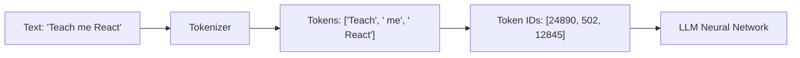
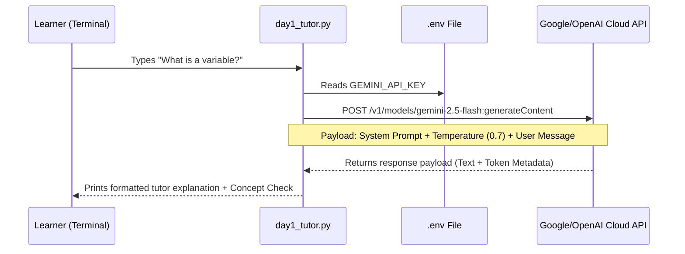

# 📖 Day 1: Generative AI Foundations & Your First Python AI Script
**Date**: November 16, 2026  
**Subject**: Full-Stack AI Engineering & The AI Notebook SaaS  
**Stage**: Stage 1 — Python & Generative AI Foundations  

---

## 1. Topic Introduction
Today marks the official kickoff of our 20-day journey to build **AI Notebook**—a persistent, living learning environment.

Before building complex features like automatic notes, vector retrieval, and Express TypeScript backends, we must establish a rock-solid mental and practical foundation:
* What is Generative AI?
* How do Large Language Models (LLMs) process and generate text?
* How does Python communicate with frontier AI models?
* How do we construct a production-ready AI script with proper system prompts and secure API key management?

---

## 2. Deep Concept Explanations

### A. Intuition: What is an LLM?
Think of an LLM as **supercharged autocomplete**.
When you type *"Thank you very..."* on your phone, the keyboard suggests *"much"*. Your phone does this by looking at past text patterns.

An LLM does the exact same thing, but at a colossal scale:
* It was fed petabytes of books, code, articles, and documentation.
* It does not "think" or "feel" like a human.
* Instead, it calculates: *"Given all the words provided so far, what is statistically the most coherent and accurate next token?"*

### B. What is a "Token"?
Computers cannot understand human letters or emotions—they only understand numbers.

* **Rule of thumb**: **1 Token $\approx$ 4 characters of English text** (or $\sim 0.75$ words).
* Words like `"apple"` might be a single token.
* Complex, rare, or code-specific words like `"useEffect"` might be split into two tokens: `["use", "Effect"]`.
* **Why this matters for engineering**:
  1. **Cost**: AI providers (Google, OpenAI, Anthropic) bill you per 1,000 or 1,000,000 tokens.
  2. **Context Window**: Every LLM has a hard memory ceiling (e.g., 128k tokens, 1M tokens). If your conversation exceeds this limit, older messages get cut off.

### C. System Prompt vs. User Prompt
In production applications, we never pass a user's raw message in isolation. We structure the prompt into two distinct layers:

1. **The System Prompt (The Persona & Guardrails)**:
   * Sets the identity, tone, constraints, and instructions for the AI.
   * The end-user never types this; it is hardcoded by you, the developer.
   * *Example*: *"You are an expert tutor. Always explain with analogies, provide code snippets, and end with a concept check."*
2. **The User Prompt (The Dynamic Request)**:
   * The immediate question or command entered by the learner.
   * *Example*: *"What is a variable in Python?"*

### D. What is "Temperature"?
Temperature is a mathematical hyperparameter (usually between `0.0` and `1.0` or `2.0`) that scales the probability distribution of the next word.

$$\text{Probability}(w_i) = \frac{e^{z_i / T}}{\sum_j e^{z_j / T}}$$

* **Temperature = 0.0 (Strict / Deterministic)**:
  * The model *always* selects the word with the highest statistical probability.
  * Essential for: JSON generation, code generation, database queries, and mathematical calculations.
* **Temperature = 0.7 – 1.0 (Creative / Balanced)**:
  * The model samples from other plausible words, introducing variety and natural tone.
  * Essential for: Conversational teaching, creative writing, brainstorming.

### E. What is an API Key?
An **API (Application Programming Interface)** key is a secure, unique credential that authenticates your Python script with the AI provider's servers. It tells the provider who you are, tracks your rate limits, and authorizes your model requests.

---

## 3. Internal Working: How the Python Script Talks to the AI

When you run `python ai-service/day1_tutor.py`, the following sequence happens under the hood:

---

## 4. Beginner Mistakes vs. Professional Approach

| Area | ❌ Beginner Mistake | ✅ Professional Approach |
| :--- | :--- | :--- |
| **Secrets Management** | Hardcoding API keys directly into Python code (`api_key = "AIzaSy..."`) and accidentally pushing them to GitHub. | Storing keys in `.env`, reading them via `os.getenv()`, and adding `.env` to `.gitignore`. |
| **Prompt Construction** | Passing only the user's question without any system instructions, resulting in generic, unpredictable answers. | Wrapping user queries inside a strict `SYSTEM_PROMPT` that defines output structure, tone, and constraints. |
| **Temperature Tuning** | Using default temperature (0.7 or 1.0) for structured tasks like JSON, causing frequent JSON parsing syntax errors. | Using `0.0` or `0.2` when structured data is required, and `0.7` for conversational teaching. |
| **Error Handling** | Letting the program crash when the network fails or when an API key is invalid. | Using `try/except` blocks and graceful fallback messages so the application never crashes unceremoniously. |

---

## 5. Interview Perspective: Common Technical Questions

1. **"What is the difference between a completion model and a chat model?"**
   * *Answer*: Older completion models simply predicted text continuation from a single string. Modern chat models accept an array of structured message roles (`system`, `user`, `assistant`), allowing multi-turn conversations and distinct behavior guardrails.
2. **"Why do LLMs sometimes struggle with counting letters or reversing words?"**
   * *Answer*: Because LLMs do not see individual characters; they see **tokens**. The word "strawberry" might be tokenized as `["straw", "berry"]`. Since the model processes the token as an atomic unit rather than individual letters, character-level arithmetic requires deliberate reasoning steps.
3. **"What is the function of the System Prompt in an enterprise AI system?"**
   * *Answer*: The system prompt establishes role boundaries, security guardrails (preventing prompt injections), output formatting instructions (e.g., JSON schemas), and domain-specific knowledge framing.

---

## 6. 🛠️ What We Built & Changed Today

Here is the exact record of progress and code created today:

### Directory & Environment Setup
* Created directory: `ai-service/` (will house all Python AI code, microservice APIs, and RAG pipelines).
* Installed core Python dependencies:
  * `python-dotenv`: To safely load API keys from environment files.
  * `google-genai`: The official Google Gemini SDK for Gemini 2.5 models.
  * `openai`: The official OpenAI SDK for GPT-4o models.

### Files Created & Updated

1. **[.env.example](file:///c:/Users/PC/Downloads/AiNoteBook/ai-service/.env.example)**
   * Template file showing required configuration keys (`GEMINI_API_KEY`, `OPENAI_API_KEY`).
2. **[.env](file:///c:/Users/PC/Downloads/AiNoteBook/ai-service/.env)**
   * Local secret file where you paste your actual API key (never committed to version control).
3. **[day1_tutor.py](file:///c:/Users/PC/Downloads/AiNoteBook/ai-service/day1_tutor.py)**
   * **Full AI Tutor Client**: Implemented multi-provider routing (supports Gemini and OpenAI).
   * **System Prompt Injection**: Embedded your master prompt: `# Role: Expert Personal Tutor – Stage-Based Progressive Deep Learning`.
   * **Interactive Loop**: Created an interactive CLI terminal session where you can chat continuously until you type `exit`.
   * **Fallback Simulator**: If no API key is set yet, it cleanly guides you on where to paste your key without crashing.
4. **[ai_notebook_master_plan.md](file:///C:/Users/PC/.gemini/antigravity/brain/b7754d59-6824-47ac-b9b1-0269da508d32/ai_notebook_master_plan.md)**
   * Created the complete 20-day master roadmap detailing every day of Python, Gen AI, and Express TypeScript.

---

## 7. Day 1 Key Takeaways & Revision Checklist
* [x] **LLMs are probabilistic token predictors**, not human brains.
* [x] **Tokens $\approx$ 4 characters**. Input tokens + Output tokens = Cost & Context limit.
* [x] **System prompt defines who the AI is**; User prompt defines what it must do right now.
* [x] **Temperature controls randomness**: $0.0$ for deterministic logic/code/JSON; $0.7+$ for conversational creativity.
* [x] **Secrets belong in `.env`**, never directly in code.

---

## 🔮 Tomorrow's Preview (Day 2)
Tomorrow we advance to **Deterministic Structured Output & Curriculum Generation**:
* Why LLMs output messy markdown by default and how we force them to output **100% valid JSON**.
* Introduction to Python dictionaries, lists, and the `json` module.
* Building the automated **Curriculum Generator** that outputs structured modules and lessons ready for our database.
