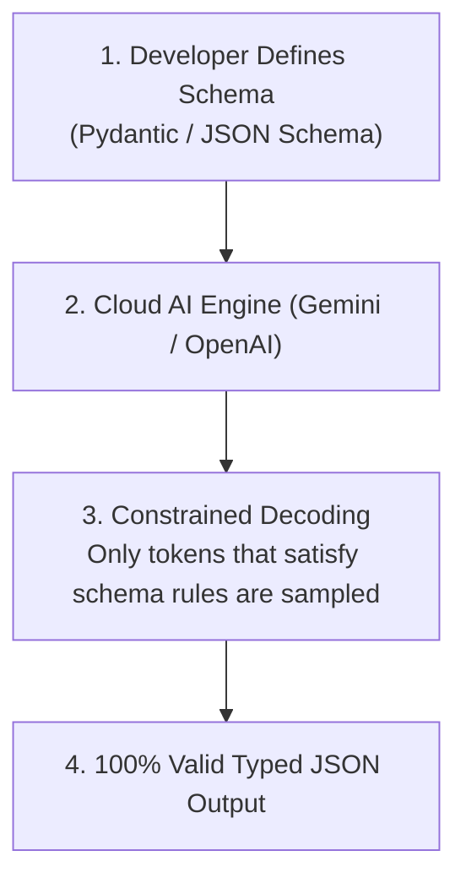

# 📖 Day 2: Prompt Engineering & Deterministic Structured Output (JSON Mode)
**Date**: November 18, 2026  
**Subject**: Full-Stack AI Engineering & The AI Notebook SaaS  
**Stage**: Stage 1 — Python & Generative AI Foundations  

---

## 1. Topic Introduction
On Day 1, we learned that Large Language Models are probabilistic text generators. By default, if you ask an AI to give you a course curriculum, it will reply with conversational prose:
> *"Sure! Here is a great course for you! First, you should learn Chapter 1: Variables. It has 3 topics..."*

While this is great for human reading, it is a disaster for software engineering.
A computer program (like our future Express TypeScript backend or SQLite database) **cannot store conversational sentences into relational tables**. A database needs exact keys: `title`, `description`, `lessons`, and numbers.

Today, we master **Deterministic Structured Output (JSON Mode)**: how to force an LLM to behave like an API that guarantees 100% valid, typed JSON matching a strict schema.

---

## 2. Deep Concept Explanations

### A. Intuition: Why Do LLMs Produce Messy Text?
Think of an LLM like an eager conversationalist at a party. If you ask: *"What are the ingredients of a cake?"*, it doesn't just hand you a spreadsheet. It says: *"Oh, cake is delicious! You'll need 2 cups of flour, some sugar, and eggs. Also make sure your oven is preheated!"*

Software systems, however, don't want friendly small talk. They want:
```json
{
  "ingredients": ["flour", "sugar", "eggs"],
  "oven_temperature_celsius": 180
}
```
Structured output is the technique of putting **mathematical guardrails** on the AI so that it is physically incapable of outputting anything other than valid JSON conforming to our rules.

---

### B. Why Does It Exist? (The Problem It Solves)
Before modern structured outputs existed, engineers had to write fragile "hacky" code:
1. You would prompt: *"Output JSON only, do not include any other words."*
2. The AI would still output: *"Here is your JSON: ```json { ... } ```"*
3. The Python or TypeScript backend would try to parse it with `JSON.parse()`, encounter backticks or extra words, and **crash**.
4. Engineers had to write messy Regular Expressions (Regex) to strip out markdown backticks and pray the JSON wasn't malformed.

**Modern Structured Outputs** solve this completely at the engine level: the AI provider forces the neural network to follow a grammar (Constrained Decoding), guaranteeing valid JSON every single time.

---

### C. How It Works: Constrained Decoding & Schema Injection



When we set `response_schema=CurriculumSchema` and `response_mime_type="application/json"`:
1. The AI engine receives our schema.
2. During the generation of each token, the AI filters out any token that would violate valid JSON syntax. For instance, if an integer is expected, the AI will mathematically refuse to generate a letter.
3. The result is pure, clean JSON with zero backticks, zero conversational filler, and guaranteed field names.

---

### D. Python Concept: Pydantic Schemas

In Python, the industry gold-standard library for data modeling and validation is **Pydantic**.
We define our data structures as Python classes inheriting from `BaseModel`:

```python
from pydantic import BaseModel, Field
from typing import List

class LessonSchema(BaseModel):
    title: str = Field(description="Clear title of the lesson")
    description: str = Field(description="Summary of what the student will learn")
    key_concepts: List[str] = Field(description="3-4 bullet points")
    estimated_minutes: int = Field(description="Estimated time in minutes")
```

#### Why use `Field(description=...)`?
In standard programming, comments are ignored by the compiler.
In Gen AI programming, **descriptions inside Pydantic fields are read by the AI as explicit prompt instructions!**
When you write `estimated_minutes: int = Field(description="Estimated time in minutes")`, the LLM reads that description and understands it must calculate an integer representing duration.

---

### E. Beginner Mistakes vs. Professional Approach

| Area | ❌ Beginner Mistake | ✅ Professional Approach |
| :--- | :--- | :--- |
| **Output Enforcement** | Begging the AI in prose: *"Please only output JSON, do not say hello, please no markdown!"* | Using native SDK parameters: `response_mime_type="application/json"` and `response_schema=MyModel`. |
| **Temperature** | Leaving temperature at default `0.7` or `1.0` when asking for JSON, resulting in hallucinated keys or syntax errors. | Lowering temperature to `0.1` or `0.2` so the model follows the structural schema strictly. |
| **Data Validation** | Assuming whatever string the AI returns is safe to insert into the database. | Passing the returned JSON into Pydantic or TypeScript interfaces to validate types before saving. |
| **Parsing** | Using string splitting or Regex to extract JSON substrings. | Using `json.loads()` on native JSON mode outputs, wrapped in defensive `try/except`. |

---

### F. Real-World Applications
Where is deterministic structured output used in production?
* **AI Notebook (Our Project)**: Generating the course curriculum (Modules, Lessons, Prerequisites) so it can be saved directly into SQLite database rows.
* **Fintech**: Extracting invoice totals, dates, and vendor names from unstructured receipts into ERP databases.
* **Customer Support**: Classifying customer emails into exact category tags (`"billing"`, `"technical_bug"`, `"refund"`).

---

### G. Interview Perspective: Technical Questions

1. **"What is Constrained Decoding in the context of LLMs?"**
   * *Answer*: Constrained decoding (or grammar-based sampling) restricts the token probability distribution at inference time. Only tokens that follow a formal grammar (such as a Context-Free Grammar or JSON schema) are allowed to be sampled, making syntactic invalidity mathematically impossible.
2. **"Why should you lower the temperature when requesting structured JSON?"**
   * *Answer*: High temperature increases randomness and encourages the model to sample lower-probability tokens. For structured data where syntax precision and schema adherence are required, a low temperature ($0.0 - 0.2$) minimizes schema drift and formatting hallucinations.
3. **"How do Pydantic models assist both the LLM and the Python backend?"**
   * *Answer*: Pydantic serves a dual role: it provides the JSON Schema definition that guides the LLM during generation, and it acts as the runtime validation engine in Python, ensuring the parsed data strictly matches our expected types.

---

## 3. 🛠️ What We Built & Changed Today

Here is the exact record of progress and code created today:

### Files Created & Updated

1. **[day2_curriculum.py](file:///c:/Users/PC/Downloads/AiNoteBook/ai-service/day2_curriculum.py)**
   * **Pydantic Hierarchy**: Built `LessonSchema`, `ModuleSchema`, and `CurriculumSchema` models.
   * **Structured Output Engine**: Implemented native JSON schema enforcement for both Google Gemini (`GenerateContentConfig(response_schema=...)`) and OpenAI (`client.beta.chat.completions.parse`).
   * **Temperature Tuning**: Configured `temperature=0.2` for deterministic course design.
   * **Offline Simulator**: Built an offline fallback so you can test curriculum generation even without an active API key.
   * **JSON Exporter**: Automatically saves generated curriculums to `sample_curriculum.json` so our future Express TypeScript backend can ingest it.

---

## 4. How to Run & Test Day 2

Run the curriculum generator in your PowerShell terminal:
```powershell
python ai-service/day2_curriculum.py
```

* It will ask: *"What topic would you like to generate a course curriculum for?"*
* Type any topic: e.g. `React Hooks` or `Node.js Backend` or `Python Machine Learning`.
* Watch the AI design a full, progressive curriculum divided into modules and lessons, and save it directly to `ai-service/sample_curriculum.json`!

---

## 5. Day 2 Key Takeaways & Revision Checklist
* [x] **LLMs naturally produce conversational text**, which breaks downstream databases and APIs.
* [x] **Structured output uses Constrained Decoding** to guarantee 100% valid JSON matching a schema.
* [x] **Pydantic models define our schemas** and field descriptions instruct the LLM on field meanings.
* [x] **Always use low temperature ($0.1 - 0.2$)** when generating structured data.
* [x] The curriculum output is now ready to be consumed by databases and APIs!

---

## 🔮 Tomorrow's Preview (Day 3)
Tomorrow we build **Teaching State & The Step-by-Step Learning Loop**:
* How to maintain conversation memory across multiple turns.
* Tracking state in Python (`current_module`, `current_lesson`, `completed_lessons`).
* Building the interactive tutor that teaches Lesson 1 in depth, answers user doubts, and only proceeds when you type `next`.
