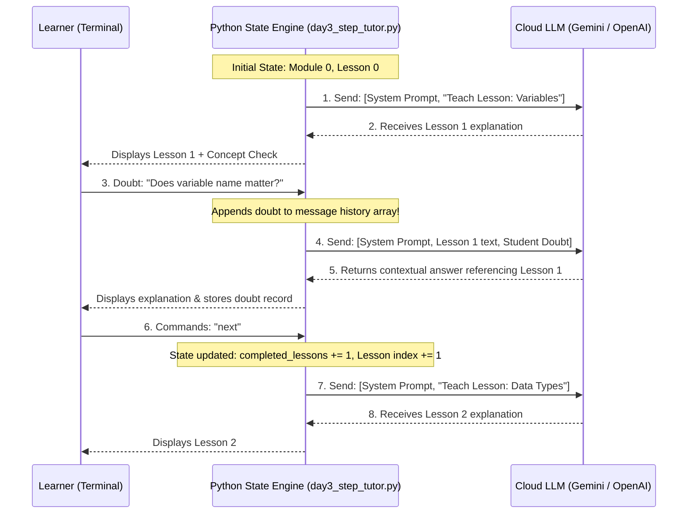

# 📖 Day 3: Conversational State & The Step-by-Step Learning Loop
**Date**: November 22, 2026  
**Subject**: Full-Stack AI Engineering & The AI Notebook SaaS  
**Stage**: Stage 1 — Python & Generative AI Foundations  

---

## 1. Topic Introduction
On Day 1, we learned how to make an isolated AI call. On Day 2, we forced the AI to output structured course curriculums in JSON.

Today, we solve a foundational challenge of AI applications: **Large Language Models have zero memory**.
Every time you call an LLM API, the model treats you like a complete stranger who has never spoken to it before. 

In this lesson, we explore **State Management & Conversational Context**:
* How to give an AI long-term and short-term memory.
* How to track a student's learning progress (`current_module`, `current_lesson`, `completed_lessons`).
* How to build an interactive teaching loop that teaches one lesson in depth, answers doubts in context, and only advances when the student commands `next`.

---

## 2. Deep Concept Explanations

### A. Intuition: The Goldfish Problem
Imagine hiring a world-class private tutor who suffers from extreme short-term memory loss. 
Every 30 seconds, their memory resets completely. 

If you say:
> **You**: *"Teach me what a loop is."*  
> **Tutor**: *"A loop repeats code."*  
> **You**: *"Can you give me an example of it?"*

If the tutor has zero memory, they will ask: *"An example of what? Who are you?"*

To solve this, before you speak to the tutor, you must quickly hand them a notepad containing the entire conversation so far:
> *"Here is what you told me 30 seconds ago: I asked for a loop, and you said a loop repeats code. Now, can you give me an example of it?"*

**This notepad is what we call the "Context Window" / "Message History Array".**

---

### B. Why Does It Exist? (Stateless HTTP vs. Stateful Learning)
Under the hood, all cloud LLM APIs (Gemini, OpenAI, Anthropic) run on **Stateless HTTP REST protocols**.
They do not store your chat sessions on their neural network.
* **Statelessness** allows AI companies to scale to hundreds of millions of users without keeping gigabytes of open memory connections for each user.
* **Statefulness** is the responsibility of **YOU**, the software engineer. Your application must maintain the state object and feed the relevant past context back to the AI on every new turn.

---

### C. How It Works: The Multi-Turn Message Array



In Python, multi-turn history is represented as a list of dictionaries with roles:
```python
messages = [
    {"role": "user", "content": "Please teach Lesson 1: Variables."},
    {"role": "model", "content": "Variables store data in memory..."},
    {"role": "user", "content": "What happens if I don't assign a value?"}
]
```
When sending this list, the AI sees the entire conversation and answers the doubt with full awareness of the lesson being taught.

---

### D. Managing Course State with Pydantic

In our `day3_step_tutor.py`, we track the learner's journey using a dedicated state model:

```python
class LearningSessionState(BaseModel):
    subject: str
    current_module_idx: int = 0
    current_lesson_idx: int = 0
    completed_lessons: List[str] = Field(default_factory=list)
    recorded_doubts: List[DoubtRecord] = Field(default_factory=list)
    lesson_chat_history: List[Dict[str, str]] = Field(default_factory=list)
```

Notice the separation:
* **Indices (`current_module_idx`, `current_lesson_idx`)**: Act like a bookmark in a textbook. They point to where the student currently is.
* **`completed_lessons`**: Tracks progress so we can calculate percentage completion ($16/24$ lessons).
* **`recorded_doubts`**: Automatically archives every question the learner asks during the lesson so we can feed it into our Living Notes engine in Week 2.
* **`lesson_chat_history`**: Tracks the immediate multi-turn dialogue for the active lesson. When the student moves to a new lesson, we clear this history to keep context clean and avoid token bloat.

---

### E. Beginner Mistakes vs. Professional Approach

| Area | ❌ Beginner Mistake | ✅ Professional Approach |
| :--- | :--- | :--- |
| **History Accumulation** | Appending every message forever into one giant list until the context window explodes or API costs skyrocket. | Scoping chat history to the **current lesson**. Once a lesson finishes, save the summary and flush the raw chat history. |
| **Pacing Control** | Letting the AI dump 5 chapters in one response because the prompt didn't enforce a step-by-step gate. | Forcing the AI to teach **one lesson at a time**, halting execution until the user explicitly commands `next`. |
| **Doubt Handling** | Treating follow-up questions as independent chats, losing the context of the code snippet just explained. | Appending the doubt to the active lesson's message array, allowing the AI to reference its previous sentences directly. |
| **State Persistence** | Keeping state as scattered local variables (`mod = 1`, `les = 2`). | Modeling state inside a typed Pydantic class that can be serialized to JSON or stored in a relational database. |

---

### F. Real-World Applications
* **AI Notebook (Our Project)**: Powers **Curriculum Mode**—the AI guides the learner through modules, waits for the learner's signals, and captures every doubt into persistent records.
* **Duolingo / Language Tutors**: Maintaining lesson progress, tracking mistakes, and gating advanced levels until exercises are completed.
* **Technical Interview Simulators**: Conducting a 45-minute coding interview step-by-step without skipping ahead to the solution.

---

### G. Interview Perspective: Technical Questions

1. **"Are LLMs stateful or stateless? How do modern chatbots maintain context?"**
   * *Answer*: LLMs are completely stateless. Every HTTP inference request is independent. Applications achieve conversational memory by maintaining an external message history array and re-submitting relevant prior exchanges with each new user turn.
2. **"What is Context Window Overflow and how do you mitigate it?"**
   * *Answer*: Every model has a maximum token limit (context window). If message history grows indefinitely, the API call will fail or truncate. Mitigation strategies include sliding window buffers (keeping only the last $N$ turns), summarizing older messages, or resetting conversation scope per topic/lesson as we do in AI Notebook.
3. **"Why should lesson state be managed by application code rather than asking the LLM to remember what lesson it is on?"**
   * *Answer*: LLMs are probabilistic and prone to hallucination or skipping steps. Business-critical state (user progress, lesson indices, completion percentages) must be managed deterministically by application code and databases, using the LLM strictly as an intelligence/reasoning engine.

---

## 3. 🛠️ What We Built & Changed Today

### Files Created & Updated

1. **[day3_step_tutor.py](file:///c:/Users/PC/Downloads/AiNoteBook/ai-service/day3_step_tutor.py)**
   * **`LearningSessionState` & `DoubtRecord`**: Pydantic models tracking curriculum position, doubts, and conversation history.
   * **`StepByStepTutor` Class**: The engine orchestrating curriculum loading, lesson delivery, doubt resolution, and progression.
   * **`teach_lesson()` Method**: Prompts the AI with strict lesson boundaries, demanding intuition, code, and concept checks.
   * **`answer_doubt()` Method**: Multi-turn doubt answering maintaining active lesson context and archiving doubts for future notes.
   * **`advance_next()` Method**: Handles the `next` command, updates completed lesson records, shifts module/lesson pointers, and triggers the next lesson.
   * **`get_status()` Method**: Calculates completion percentage and lists all mastered topics and recorded doubts.

---

## 4. How to Run & Test Day 3

Run the interactive tutor in your PowerShell terminal:
```powershell
python ai-service/day3_step_tutor.py
```

Try this interactive test flow:
1. The tutor will greet you and teach **Lesson 1** of your loaded course.
2. Type a doubt about the lesson (e.g., *"Why do we need this instead of plain variables?"*). Notice how it explains with full context and saves the doubt!
3. Type `status` to view your progress dashboard.
4. Type `next` to complete Lesson 1 and advance to **Lesson 2**.
5. Type `exit` when you want to wrap up.

---

## 5. Day 3 Key Takeaways & Revision Checklist
* [x] **LLMs are stateless**; the application must own and pass the conversation history.
* [x] **Keep conversation history scoped** (e.g., to the active lesson) to keep token costs low and responses focused.
* [x] **Application state must be deterministic** (using code/models), not left to the AI to guess.
* [x] Doubts asked during lessons are now **captured as structured records** ready for Day 10 (Living Notes).

---

## 🔮 Tomorrow's Preview (Day 4)
Tomorrow we build **The Python AI Microservice with FastAPI**:
* Converting our standalone Python scripts (`curriculum`, `tutor`, `doubts`) into a real HTTP REST API.
* Defining endpoints: `POST /ai/generate-curriculum`, `POST /ai/teach-lesson`, `POST /ai/answer-doubt`.
* Inspecting live Swagger API documentation at `http://localhost:8000/docs`.
* Preparing the AI Brain so our **Express TypeScript backend** (starting Day 5) can call it seamlessly!
