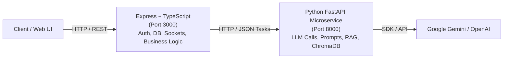

# 📖 Day 4: Creating the Python AI Microservice with FastAPI
**Date**: November 24, 2026  
**Subject**: Full-Stack AI Engineering & The AI Notebook SaaS  
**Stage**: Stage 1 — Python & Generative AI Foundations  

---

## 1. Topic Introduction
Over Days 1 through 3, we built powerful Python scripts to call LLMs, generate structured curriculums, and manage interactive step-by-step teaching sessions. 

However, right now, our code only runs as isolated command-line scripts (`python dayX.py`). 
In modern production applications, an AI system does not run inside a terminal loop on a developer's laptop. It runs as a **Microservice**: an independent web service listening for requests over the network.

Starting tomorrow on **Day 5**, we begin **Stage 2: Express + TypeScript Backend Core**. 
For our Express TypeScript server to ask our Python code to *"generate a course"* or *"answer a student doubt"*, our Python code must expose **HTTP REST endpoints**.

Today, we use **FastAPI** to transform our AI logic into a high-performance, production-ready AI Microservice.

---

## 2. Deep Concept Explanations

### A. Intuition: The Restaurant Analogy
Imagine a busy restaurant:
* **The Waiter (Express + TypeScript)**: Stands in the dining room, greets customers, takes their orders, manages table seating, and brings bills.
* **The Master Chef (Python AI Service)**: Stays in the kitchen, specializing in crafting complex recipes (AI models, embeddings, RAG).
* **The Communication Window (HTTP API)**: The waiter doesn't drag the customer into the kitchen. Instead, the waiter hands a structured ticket through the kitchen window: *"Order: React Curriculum"*. The chef prepares it, places the structured dish on the counter, and rings the bell.

By separating the **Application Manager (Express)** from the **AI Brain (Python)**, both systems do what they do best without stepping on each other.

---

### B. Why Does a Microservice Architecture Exist? (Separation of Concerns)



1. **Language Specialization**: Express + TypeScript is unmatched for building fast, type-safe web servers and handling client connections. Python is the undisputed king of Machine Learning and Generative AI libraries. A microservice lets you use both without compromises.
2. **Independent Scaling**: If 10,000 users are browsing notes, the Express server handles the traffic easily without wasting AI compute. If 500 users ask heavy AI questions, only the Python AI service scales up its workers.
3. **Fault Isolation**: If an LLM API experiences high latency or an error, it is caught in the Python microservice without bringing down your entire user database or web server.

---

### C. How It Works: FastAPI, ASGI & Uvicorn

In Python, traditional web frameworks (like old Flask or Django) used **WSGI (Web Server Gateway Interface)**, which was synchronous (one request blocked the thread until it finished).

**FastAPI** is built on **ASGI (Asynchronous Server Gateway Interface)** powered by **Uvicorn**:
* **Asynchronous (`async/await`)**: The server can handle thousands of incoming HTTP connections concurrently while waiting for external cloud LLM responses.
* **Built on Pydantic**: Every request body is automatically validated against Pydantic schemas. If a client sends invalid types, FastAPI automatically rejects it with clear HTTP 422 error details before your code ever runs.
* **Automatic OpenAPI / Swagger Documentation**: FastAPI automatically reads your Pydantic models and generates an interactive web interface at `/docs` where you can test every endpoint with a single click.

---

### D. Practical Code Breakdown: `ai-service/api.py`

Let's examine how our endpoints are structured:

#### 1. Defining Request/Response Schemas
```python
class TeachLessonRequest(BaseModel):
    subject: str = Field(..., example="React Mastery")
    module_title: str = Field(..., example="Hooks Fundamentals")
    lesson_title: str = Field(..., example="Understanding useEffect")
    lesson_description: Optional[str] = ""
    key_concepts: Optional[List[str]] = []
```
This guarantees that whenever Express calls `/ai/teach-lesson`, Express *must* provide `subject`, `module_title`, and `lesson_title`.

#### 2. Defining the Route Handler
```python
@app.post("/ai/teach-lesson", response_model=TeachLessonResponse, tags=["Tutor"])
def api_teach_lesson(payload: TeachLessonRequest):
    prompt = (
        f"Teach lesson: {payload.lesson_title}\n"
        f"Module: {payload.module_title}\n"
        f"Subject: {payload.subject}"
    )
    explanation = call_llm([{"role": "user", "content": prompt}])
    return TeachLessonResponse(
        subject=payload.subject,
        module_title=payload.module_title,
        lesson_title=payload.lesson_title,
        explanation=explanation
    )
```

#### 3. Cross-Origin Resource Sharing (CORS)
```python
app.add_middleware(
    CORSMiddleware,
    allow_origins=["*"],
    allow_methods=["*"],
    allow_headers=["*"],
)
```
This ensures that when our Express server (or local web browser) calls `http://localhost:8000`, the requests are not blocked by browser origin security policies.

---

### E. Beginner Mistakes vs. Professional Approach

| Area | ❌ Beginner Mistake | ✅ Professional Approach |
| :--- | :--- | :--- |
| **API Contracts** | Accepting untyped raw dictionaries (`data = request.json()`), leading to runtime `KeyError` crashes when keys are missing. | Defining strict Pydantic `BaseModel` classes for both Request and Response payloads. |
| **Monolithic Coupling** | Trying to write all database queries, auth cookies, frontend routes, and LLM calls in one giant Python file. | Decoupling the AI logic into a dedicated microservice with clear REST boundaries. |
| **Error Handling** | Letting unhandled exceptions return generic 500 HTML error pages to the caller. | Catching exceptions and raising standard `HTTPException(status_code=500, detail=...)` with structured JSON errors. |
| **Documentation** | Writing manual Word docs or Markdown files that become outdated whenever an API field changes. | Relying on FastAPI's live auto-generated Swagger UI (`/docs`) which stays 100% in sync with code. |

---

### F. Real-World Applications
* **Uber / Netflix**: Thousands of microservices written in different languages (Go, Java, Node.js, Python) communicating over HTTP/gRPC.
* **Notion AI**: The main web app (Node.js/React) dispatches document summarization and drafting tasks to a specialized Python AI cluster.
* **AI Notebook (Our Architecture)**: Express TypeScript orchestrates user notebooks, while FastAPI handles curriculum design, teaching, and living notes.

---

### G. Interview Perspective: Technical Questions

1. **"What is the difference between WSGI and ASGI in Python?"**
   * *Answer*: WSGI is synchronous and processes requests sequentially per worker thread. ASGI is asynchronous, allowing a single event loop to handle thousands of concurrent I/O-bound requests (such as waiting for cloud LLM API calls) without blocking.
2. **"Why use a dedicated microservice for AI instead of running everything inside Node.js or Python?"**
   * *Answer*: Decoupling provides independent scalability, resilience against external API rate limits, clean service boundaries, and allows each layer of the stack to use the ecosystem best suited for its job (Node.js for real-time web applications, Python for AI/ML/data tooling).
3. **"How does FastAPI achieve automatic validation?"**
   * *Answer*: FastAPI leverages Python type hints and Pydantic models. It parses incoming JSON request bodies against the specified Pydantic schema before passing control to the route handler, automatically generating RFC-compliant 422 error responses if validation fails.

---

## 3. 🛠️ What We Built & Changed Today

### Files Created & Updated

1. **[api.py](file:///c:/Users/PC/Downloads/AiNoteBook/ai-service/api.py)**
   * **FastAPI Application**: Initialized app with CORS middleware and descriptive OpenAPI metadata.
   * **`GET /health`**: Health check probe returning service health and version.
   * **`POST /ai/generate-curriculum`**: Accepts subject and returns full structured JSON syllabus matching `CurriculumSchema`.
   * **`POST /ai/teach-lesson`**: Accepts lesson metadata and returns in-depth pedagogical explanation with code and concept check.
   * **`POST /ai/answer-doubt`**: Accepts student doubt and active lesson text, returning contextual doubt resolution.
   * **Uvicorn Server Launcher**: Configured with live-reload support on port `8000`.

---

## 4. How to Run & Test Day 4

### Step 1: Start the AI Microservice
Run this command in your PowerShell terminal:
```powershell
python ai-service/api.py
```

You will see output similar to:
```
INFO:     Uvicorn running on http://0.0.0.0:8000 (Press CTRL+C to quit)
INFO:     Started reloader process
INFO:     Application startup complete.
```

### Step 2: Open the Interactive Swagger Documentation
Open your web browser and navigate to:
👉 **`http://localhost:8000/docs`**

You will see the interactive Swagger UI:
1. Click on **`POST /ai/generate-curriculum`** $\rightarrow$ Click **"Try it out"**.
2. Put `{"subject": "React Hooks"}` in the request body $\rightarrow$ Click **Execute**.
3. Watch your Python microservice process the request and return the structured JSON curriculum!
4. Test **`POST /ai/teach-lesson`** and **`POST /ai/answer-doubt`** directly from the browser.

---

## 5. Day 4 Key Takeaways & Stage 1 Wrap-up Checklist
* [x] **Stage 1 (Days 1–4) is now COMPLETE!**
* [x] We mastered LLM tokens, prompts, and temperature.
* [x] We forced deterministic structured JSON outputs with Pydantic.
* [x] We built conversational state and step-by-step teaching loops.
* [x] We exposed all AI capabilities as clean HTTP REST endpoints.
* [x] **The AI Brain is ready!** Now we can build the Main Application Manager in Express + TypeScript.

---

## 🔮 Tomorrow's Preview (Day 5: Stage 2 Kickoff!)
Tomorrow we enter **Stage 2: Express & TypeScript Backend Core**:
* What is TypeScript and why does every major tech company use it?
* Static typing, interfaces, and setting up `tsconfig.json`.
* Creating our backend directory `backend/` and initializing our first typed Express server with live reload!
